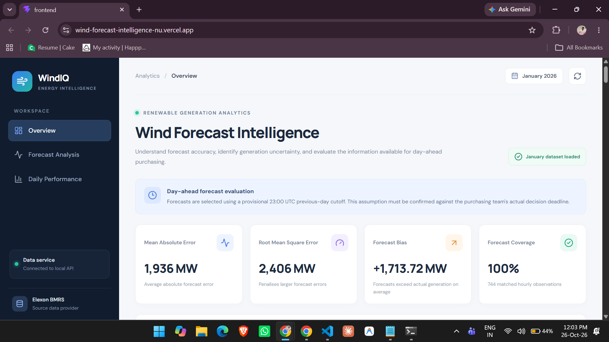
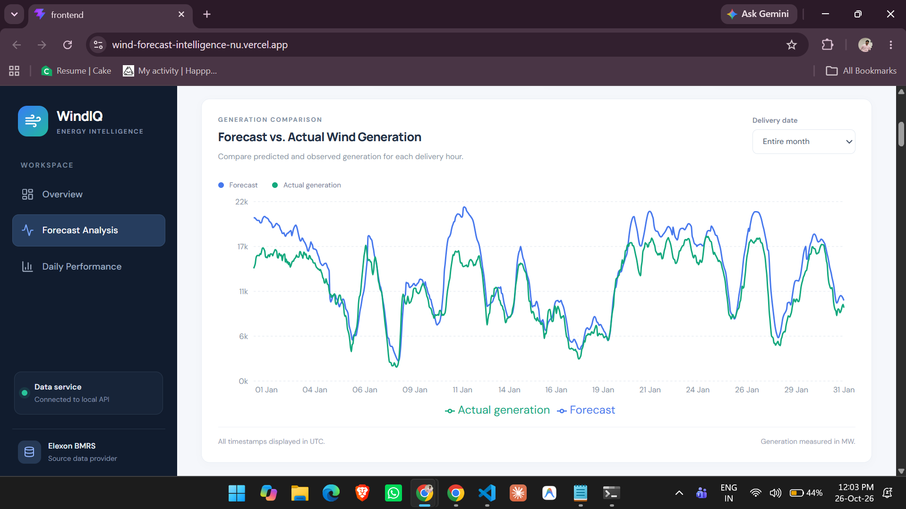
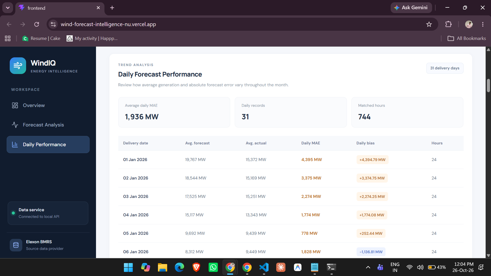
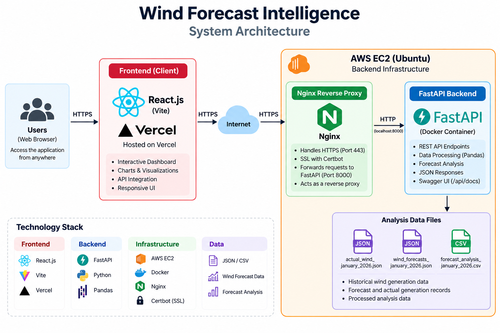
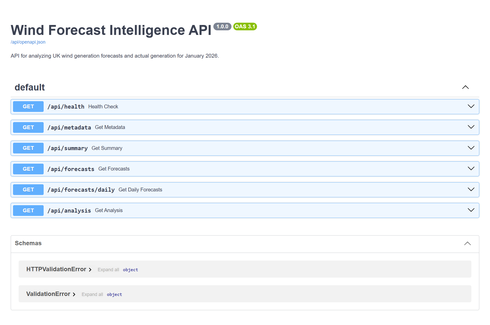

# Wind Forecast Intelligence

**A data-driven application for evaluating UK wind generation forecasts against actual generation.**

Wind Forecast Intelligence analyses forecast accuracy, compares predicted and actual wind generation, and presents performance metrics to help users understand forecast errors and potential operational implications.

**Live Demo:** https://wind-forecast-intelligence-nu.vercel.app/  
**Backend API:** https://windforecastintelligence.duckdns.org  
**API Documentation:** https://windforecastintelligence.duckdns.org/api/docs  
**GitHub Repository:** https://github.com/MadanGarimella/wfiass

---

## Table of Contents

- [Overview](#overview)
- [Problem Statement](#problem-statement)
- [Objectives](#objectives)
- [Features](#features)
- [Screenshots](#screenshots)
- [Key Analytical Results](#key-analytical-results)
- [Forecast Cutoff Assumption](#forecast-cutoff-assumption)
- [System Architecture](#system-architecture)
- [Technology Stack](#technology-stack)
- [Data Sources and Processing](#data-sources-and-processing)
- [API Endpoints](#api-endpoints)
- [Project Structure](#project-structure)
- [Local Installation and Setup](#local-installation-and-setup)
- [Docker Deployment](#docker-deployment)
- [Cloud Deployment](#cloud-deployment)
- [Testing](#testing)
- [Limitations](#limitations)
- [Future Improvements](#future-improvements)
- [AI Tool Disclosure](#ai-tool-disclosure)
- [Author](#author)

---

## Overview

Wind Forecast Intelligence is a full-stack web application built to analyse the accuracy of UK wind generation forecasts using historical forecast and actual generation data.

The application processes wind generation data, evaluates forecast errors, calculates statistical performance metrics, and presents the results through a web-based dashboard.

The project demonstrates how forecast analysis can help identify systematic prediction errors and provide useful insights for energy forecasting and operational decision-making.

The application is deployed using a modern cloud architecture:

- **Frontend:** React and Vite, hosted on Vercel.
- **Backend:** FastAPI, deployed on AWS EC2.
- **Containerization:** Docker.
- **Reverse proxy and HTTPS:** Nginx and Certbot.
- **Data processing:** Python and Pandas.

### Live Application

**Frontend:** Add your Vercel deployment URL here.

**Backend health check:**  
https://windforecastintelligence.duckdns.org/api/health

**Interactive API documentation:**  
https://windforecastintelligence.duckdns.org/api/docs

---

## Problem Statement

Wind generation is variable and depends on weather conditions. Forecasting errors can affect electricity system planning, operational decisions, and the assessment of potential energy procurement requirements.

Forecasts and actual generation values may differ significantly. Understanding the magnitude, direction, and distribution of these errors is therefore important.

This project addresses the analytical problem of comparing forecast wind generation against actual generation and presenting measurable forecast performance indicators.

The application focuses on:

- Comparing forecast and actual wind generation.
- Measuring forecast error.
- Evaluating forecast accuracy using statistical metrics.
- Identifying systematic overforecasting or underforecasting.
- Presenting analytical results through an accessible dashboard.

**Scope note:** This application evaluates forecast performance. It does not calculate actual electricity procurement requirements or financial settlement costs because the current dataset does not contain electricity demand, other generation sources, or the necessary market pricing and settlement information.

---

## Objectives

The main objectives of this project are to:

1. Build a full-stack application for wind generation forecast analysis.
2. Process historical forecast and actual generation datasets.
3. Calculate standard forecast accuracy metrics.
4. Visualize forecast performance and prediction errors.
5. Expose analytical data through REST API endpoints.
6. Deploy the application using cloud infrastructure and Docker.
7. Provide a reproducible setup for local development and testing.

---

## Features

### Forecast Analysis

- Compare forecast wind generation with actual generation.
- Analyse forecast errors using historical data.
- Examine differences between predicted and actual generation.
- Present forecast performance indicators.

### Performance Metrics

The application reports standard statistical measures, including:

- **Mean Absolute Error (MAE):** Average absolute difference between forecast and actual generation.
- **Root Mean Squared Error (RMSE):** Square root of the average squared forecast error.
- **Forecast Bias:** Average signed difference between forecast and actual generation.

### Interactive Web Application

- React-based frontend.
- Data retrieved through backend API endpoints.
- Dashboard-oriented presentation of analysis results.
- Separation of frontend and backend services.

### Backend API

- FastAPI REST API.
- JSON responses for forecast and analytical data.
- Interactive API documentation through Swagger UI.
- Health-check endpoint for service verification.

### Deployment

- Dockerized backend.
- AWS EC2 hosting.
- Nginx reverse proxy.
- HTTPS configuration.
- Vercel frontend deployment.

---

## Screenshots

### Dashboard Overview



### Forecast vs. Actual Generation



### Forecast Error Analysis



### System Architecture



### API Documentation



**Recommended screenshots:**

| Screenshot | What it should show |
|---|---|
| `dashboard-overview.png` | Main dashboard and its key metrics |
| `forecast-vs-actual.png` | Forecast and actual generation comparison |
| `forecast-error-analysis.png` | Error metrics and analytical results |
| `system-architecture.png` | Frontend, backend, API, and deployment components |
| `api-documentation.png` | FastAPI Swagger UI with available endpoints |

Use screenshots from the actual deployed application. Avoid including credentials, private keys, account information, or other sensitive information.

---

## Key Analytical Results

The current analysis of the January 2026 dataset produced the following results:

| Metric | Result |
|---|---:|
| Mean Absolute Error (MAE) | 1,935.73 MW |
| Root Mean Squared Error (RMSE) | 2,406.10 MW |
| Forecast Bias | +1,713.72 MW |

### Interpretation

**Mean Absolute Error — 1,935.73 MW**

The forecast differs from actual wind generation by approximately 1,935.73 MW on average, measured using the absolute forecast error.

**Root Mean Squared Error — 2,406.10 MW**

RMSE penalizes larger forecast errors more heavily than MAE because the errors are squared before averaging. The reported RMSE is approximately 2,406.10 MW.

**Forecast Bias — +1,713.72 MW**

Forecast bias is calculated as forecast generation minus actual generation. A positive bias indicates that the forecasts overestimated actual wind generation on average across the observations included in the analysis.

These values describe the current dataset and analysis. They should not be interpreted as guaranteed performance for other periods or as evidence that the forecasting model itself was trained by this application.

---

## Forecast Cutoff Assumption

Forecast cutoff timing is important when evaluating forecasts for operational use.

For this implementation, the provisional assumption is:

**23:00 UTC on the day before the forecast date.**

This is an implementation assumption, not a verified business requirement.

A production implementation should confirm the required cutoff time, the relevant timezone, forecast publication timestamps, and which forecast version was available at the cutoff.

To ensure a fair historical evaluation, the selected forecast must be one that was genuinely available at the specified cutoff. Forecasts published or revised afterward should not be used to represent information available to a decision-maker at that earlier time.

---

## System Architecture

The application uses a separate frontend and backend architecture.

```text
                  USER
                    |
                    v
        React + Vite Frontend
              Hosted on Vercel
                    |
                    | HTTPS / REST API
                    v
          Nginx Reverse Proxy
              Hosted on AWS EC2
                    |
                    v
             FastAPI Backend
             Running in Docker
                    |
                    v
         Python / Pandas Analysis
                    |
                    v
          Historical Data Files
          JSON and CSV Datasets
```

### Architecture Components

**1. Frontend — Vercel**

The React application provides the user interface and requests forecast and analytical information from the backend API.

**2. Reverse Proxy — Nginx**

Nginx receives HTTPS requests and forwards API requests to the locally hosted FastAPI service.

**3. Backend — FastAPI**

FastAPI exposes endpoints for health checks, metadata, forecast records, daily forecasts, summary metrics, and analytical results.

**4. Data Processing — Python and Pandas**

Python and Pandas support the processing and analysis of forecast and actual wind generation data.

**5. Containerization — Docker**

Docker packages the backend application and its dependencies into a container to support consistent deployment.

---

## Technology Stack

| Category | Technology |
|---|---|
| Frontend | React |
| Frontend Build Tool | Vite |
| Frontend Hosting | Vercel |
| Backend Framework | FastAPI |
| Programming Language | Python |
| Data Processing | Pandas |
| API Format | REST / JSON |
| API Documentation | Swagger UI / OpenAPI |
| Containerization | Docker |
| Cloud Infrastructure | AWS EC2 |
| Web Server / Reverse Proxy | Nginx |
| HTTPS | Certbot / Let's Encrypt |
| Version Control | Git and GitHub |
| Testing | Pytest |

---

## Data Sources and Processing

The current analysis uses three local data files.

| File | Purpose |
|---|---|
| `actual_wind_january_2026.json` | Actual wind generation observations |
| `wind_forecasts_january_2026.json` | Wind generation forecast observations |
| `forecast_analysis_january_2026.csv` | Processed forecast analysis data |

### Processing Workflow

1. Load the forecast and actual generation datasets.
2. Read and process the relevant observations.
3. Match forecast and actual generation records according to the application's analysis logic.
4. Calculate forecast errors.
5. Calculate forecast accuracy metrics.
6. Make the resulting information available through the API.
7. Display the retrieved information in the frontend.

### Forecast Error Definition

The forecast error is defined as:

**Forecast Error = Forecast Generation − Actual Generation**

Interpretation:

- **Positive error:** Forecast generation is higher than actual generation.
- **Negative error:** Forecast generation is lower than actual generation.
- **Zero error:** Forecast and actual generation are equal.

### Metrics Definitions

**Mean Absolute Error (MAE)**

\[
MAE = \frac{1}{n}\sum_{i=1}^{n}|F_i-A_i|
\]

**Root Mean Squared Error (RMSE)**

\[
RMSE = \sqrt{\frac{1}{n}\sum_{i=1}^{n}(F_i-A_i)^2}
\]

**Forecast Bias**

\[
Bias = \frac{1}{n}\sum_{i=1}^{n}(F_i-A_i)
\]

Where:

- \(F_i\) is the forecast generation for observation \(i\).
- \(A_i\) is the actual generation for observation \(i\).
- \(n\) is the number of matched observations included in the analysis.

The formulas describe the metrics conceptually. The reported results depend on the observations included in the application's calculations.

---

## API Endpoints

The backend exposes the following endpoints.

Base URL:

```text
https://windforecastintelligence.duckdns.org/api
```

| Method | Endpoint | Purpose |
|---|---|---|
| GET | `/health` | Check backend service health |
| GET | `/metadata` | Retrieve dataset or application metadata |
| GET | `/summary` | Retrieve summary analytical metrics |
| GET | `/forecasts` | Retrieve forecast records |
| GET | `/forecasts/daily` | Retrieve daily forecast information |
| GET | `/analysis` | Retrieve forecast analysis results |

### Example Requests

**Health check**

```bash
curl https://windforecastintelligence.duckdns.org/api/health
```

**Summary metrics**

```bash
curl https://windforecastintelligence.duckdns.org/api/summary
```

**Forecast data**

```bash
curl https://windforecastintelligence.duckdns.org/api/forecasts
```

**Daily forecast data**

```bash
curl https://windforecastintelligence.duckdns.org/api/forecasts/daily
```

**Analysis results**

```bash
curl https://windforecastintelligence.duckdns.org/api/analysis
```

### Interactive API Documentation

Explore the API and inspect available request and response schemas through Swagger UI:

https://windforecastintelligence.duckdns.org/api/docs

The OpenAPI specification is available at:

https://windforecastintelligence.duckdns.org/api/openapi.json

---

## Project Structure

The repository follows a separate frontend and backend organization.

```text
wfiass/
│
├── frontend/
│   ├── src/
│   │   ├── services/
│   │   │   └── api.js
│   │   └── ...
│   ├── public/
│   ├── package.json
│   ├── index.html
│   └── ...
│
├── backend/
│   ├── main.py
│   ├── requirements.txt
│   ├── Dockerfile
│   ├── .dockerignore
│   ├── data/
│   │   ├── actual_wind_january_2026.json
│   │   ├── wind_forecasts_january_2026.json
│   │   └── forecast_analysis_january_2026.csv
│   └── ...
│
├── docs/
│   └── images/
│
├── docker-compose.yml
└── README.md
```

*This tree illustrates the intended repository organization. Files represented by `...` are omitted for readability.*

---

## Local Installation and Setup

Follow these instructions to run the application locally.

### Prerequisites

Install the following:

- Git
- Node.js and npm
- Python 3.12 or a compatible Python version
- pip

Docker is optional for running the backend directly.

### 1. Clone the Repository

```bash
git clone https://github.com/MadanGarimella/wfiass.git
cd wfiass
```

### 2. Configure the Backend

Open a terminal in the repository root:

```bash
cd backend
```

Create a virtual environment.

**Windows PowerShell:**

```powershell
python -m venv .venv
.\.venv\Scripts\Activate.ps1
```

**macOS / Linux:**

```bash
python3 -m venv .venv
source .venv/bin/activate
```

Install the Python dependencies:

```bash
pip install -r requirements.txt
```

Start the backend:

```bash
uvicorn main:app --reload --host 127.0.0.1 --port 8000
```

The backend should now be available at:

```text
http://127.0.0.1:8000
```

Interactive API documentation:

```text
http://127.0.0.1:8000/api/docs
```

Keep the backend terminal running.

### 3. Configure the Frontend

Open a second terminal.

Navigate to the frontend directory:

```bash
cd frontend
```

Install the dependencies:

```bash
npm install
```

Configure the frontend API URL in the local `.env` file:

```env
VITE_API_BASE_URL=http://127.0.0.1:8000/api
```

Start the Vite development server:

```bash
npm run dev
```

Open the local frontend URL shown in your terminal. The default Vite development URL is:

```text
http://localhost:5173
```

### 4. Verify the Application

Check the following:

- The frontend loads successfully.
- The backend health endpoint returns a successful response.
- Forecast and analysis requests return data.
- Dashboard metrics and visualizations load correctly.
- The browser console does not report API or CORS errors.

**Important:** The local `.env` file is for development. The production frontend uses the Vercel environment variable `VITE_API_BASE_URL` configured for the deployed backend.

---

## Docker Deployment

The backend is containerized with Docker.

From the backend directory, build the Docker image:

```bash
docker build -t wind-forecast-api:latest .
```

Run the container locally:

```bash
docker run -d \
  --name wind-forecast-api \
  --restart unless-stopped \
  -p 127.0.0.1:8000:8000 \
  wind-forecast-api:latest
```

Check the running container:

```bash
docker ps
```

Inspect the backend logs:

```bash
docker logs wind-forecast-api
```

Test the backend health endpoint:

```bash
curl http://127.0.0.1:8000/api/health
```

To stop the container:

```bash
docker stop wind-forecast-api
```

To remove the container:

```bash
docker rm wind-forecast-api
```

The port binding above exposes the API only on the local machine. This is appropriate for the production setup, where Nginx acts as the public reverse proxy.

---

## Cloud Deployment

The deployed application separates the frontend and backend.

### Frontend Deployment

**Platform:** Vercel

The frontend is deployed from the GitHub repository using the `frontend` directory as the project root.

Production environment variable:

```env
VITE_API_BASE_URL=https://windforecastintelligence.duckdns.org/api
```

The variable must be available to the production build.

### Backend Deployment

**Platform:** AWS EC2  
**Operating System:** Ubuntu  
**Container Runtime:** Docker  
**Reverse Proxy:** Nginx  
**HTTPS:** Certbot / Let's Encrypt

The backend runs inside a Docker container and is bound to the EC2 instance's loopback interface. Nginx forwards public HTTPS requests to the local backend service.

### Deployment Design

```text
Browser
   |
   | HTTPS
   v
Vercel-hosted React Application
   |
   | HTTPS API Requests
   v
Nginx on AWS EC2
   |
   | Local HTTP
   v
FastAPI Docker Container
   |
   v
Analysis Data
```

### Operational Notes

- The public API is accessed through HTTPS.
- The backend container is configured to restart automatically.
- The Docker container's port is bound to `127.0.0.1` on the server.
- Nginx handles public requests and forwards them to FastAPI.
- The frontend and backend can be deployed independently.
- The current DuckDNS hostname points to the EC2 instance's public IPv4 address.

**IP address note:** The deployment uses the instance's public IP address rather than a dedicated Elastic IP. If the EC2 public IP changes, the DNS record and any associated deployment configuration may need to be updated.

---

## Testing

The project includes backend tests.

The current recorded test result is:

**5 tests passed.**

Run the backend tests from the backend directory:

```bash
pytest
```

If `pytest` is not installed in your active environment, install the project's test dependencies or install it separately:

```bash
pip install pytest
```

### Manual API Verification

The following endpoints can be checked manually:

```text
/api/health
/api/metadata
/api/summary
/api/forecasts
/api/forecasts/daily
/api/analysis
```

For deployed verification, use the public API base URL:

```text
https://windforecastintelligence.duckdns.org/api
```

Automated test results and manual deployment checks are distinct: passing unit tests does not, by itself, guarantee that every production integration is functioning correctly.

---

## Limitations

The current implementation has the following limitations.

### 1. Dataset Coverage

The current analysis focuses on January 2026 data. Results from this period may not represent seasonal variation or forecast performance across the entire year.

### 2. Forecast Cutoff

The 23:00 UTC day-before cutoff is provisional. It must be confirmed against the actual business requirements and the timestamps available in the source data.

### 3. Procurement Requirements

The current dataset does not include electricity demand, other generation sources, or complete system-balancing information.

Therefore, the application does not calculate actual electricity procurement requirements or establish how much additional generation or electricity must be purchased.

### 4. Financial Impact

The current implementation does not calculate monetary losses, imbalance charges, settlement costs, or savings. These calculations would require suitable market prices, settlement rules, and relevant operational data.

### 5. Forecast Availability at Cutoff

A rigorous operational evaluation must ensure that every forecast used was available at the relevant decision cutoff. This requires reliable forecast publication timestamps and a clear forecast-version selection policy.

### 6. Historical Evaluation

The reported metrics describe the observations included in the current analysis. Additional validation across different dates, seasons, and forecast horizons would be necessary before drawing broader conclusions.

---

## Future Improvements

Potential enhancements include:

- Extend the analysis to additional months and years.
- Add configurable forecast cutoffs and timezone handling.
- Validate forecast availability using publication timestamps.
- Support additional forecast horizons.
- Add filters for dates and time intervals.
- Improve error distribution and outlier analysis.
- Compare performance across different forecast horizons.
- Add data ingestion and scheduled processing pipelines.
- Introduce persistent storage for larger datasets.
- Add automated CI/CD workflows.
- Improve automated integration and deployment testing.
- Incorporate electricity demand and other generation data.
- Add market pricing and settlement information to support financial impact analysis.
- Introduce role-based access controls if the application evolves into a multi-user platform.

These are potential future enhancements and are not claims about functionality currently implemented.

---

## AI Tool Disclosure

AI-assisted tools were used during development to support implementation, troubleshooting, and documentation.

The project source code, analytical assumptions, results, and deployment behavior should be reviewed and validated against the actual implementation and dataset.

AI assistance does not replace technical verification, testing, or responsibility for the submitted work.

---

## Author

**Madan Garimella**

GitHub: https://github.com/MadanGarimella

Project: [Wind Forecast Intelligence](https://github.com/MadanGarimella/wfiass)

---

*Wind Forecast Intelligence — analysing wind generation forecast accuracy through data and measurable performance metrics.*
